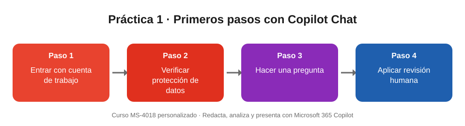

# Práctica 1. Primeros pasos con Microsoft 365 Copilot Chat

## Objetivo de la práctica:
Al finalizar la práctica, serás capaz de:
- Acceder a Microsoft 365 Copilot Chat con tu cuenta de trabajo y comprobar que tus datos están protegidos.
- Diferenciar lo que puede hacer Copilot Chat básico de lo que añade Microsoft 365 Copilot con licencia.
- Aplicar los cuatro pasos de uso responsable: revisar, validar, aprobar y proteger.

## Objetivo Visual


## Duración aproximada:
- 5 minutos (práctica de refuerzo; en la sesión el instructor la muestra durante el Módulo 1).

## Tabla de ayuda:
| Recurso | Valor |
| --- | --- |
| Copilot Chat (web) | https://m365.cloud.microsoft |
| Aplicación de escritorio o móvil | Microsoft 365 Copilot |
| Cuenta | Tu cuenta de trabajo de Microsoft 365 (no una cuenta personal) |
| Datos de la práctica | Ficticios, incluidos en esta guía |

## Instrucciones
### Tarea 1. Acceder a Copilot Chat con la cuenta de trabajo.
Paso 1. Abrir el navegador e ingresar a https://m365.cloud.microsoft, o abrir la aplicación **Microsoft 365 Copilot**.

Paso 2. Iniciar sesión con la cuenta de trabajo de Microsoft 365.

Paso 3. Seleccionar **Copilot** (o **Chat**) en el menú lateral.

Paso 4. Comprobar que aparece el indicador de **protección de datos de empresa** (icono de escudo) junto al cuadro de chat. Este indicador confirma que tus indicaciones y respuestas no se usan para entrenar los modelos y se quedan dentro del límite de tu organización.

### Tarea 2. Identificar qué versión de Copilot tienes.
Paso 1. Observar si en la parte superior del chat aparece un selector **Trabajo / Web**. Si aparece, tienes Microsoft 365 Copilot con licencia; si no aparece, estás usando Copilot Chat básico.

Paso 2. Escribir la siguiente indicación y enviarla:

```
¿Qué puedes hacer por mí en mi trabajo diario? Dame 5 ejemplos concretos para un usuario de Word, Excel, PowerPoint, Outlook y Teams.
```

Paso 3. Si tienes licencia, seleccionar **Trabajo** y escribir:

```
Resume los correos más importantes que recibí ayer y dime qué acciones tengo pendientes.
```

Paso 4. Si no tienes licencia, comprobar que Copilot Chat no puede leer tu buzón por sí mismo: para trabajar con un contenido debes pegarlo en el chat o cargar el archivo con el botón **+**.

### Tarea 3. Aplicar la revisión humana.
Paso 1. Escribir y enviar la indicación:

```
Explica en 3 viñetas qué es la protección de datos de empresa en Microsoft 365 Copilot. Incluye las fuentes que usaste.
```

Paso 2. Revisar la respuesta completa: ¿responde exactamente a lo que pediste?

Paso 3. Validar al menos una de las fuentes citadas, abriendo el enlace que entrega Copilot.

Paso 4. Decidir si usarías la respuesta tal como está o qué corregirías antes de compartirla.

### Resultado esperado
- Accediste a Copilot Chat con tu cuenta de trabajo y viste el indicador de protección de datos de empresa.
- Sabes si tienes Copilot Chat básico (web + contenido que tú aportas) o Microsoft 365 Copilot con licencia (además, tus datos de trabajo según tus permisos).
- Revisaste y validaste una respuesta antes de darla por buena.

| Copilot Chat básico | Microsoft 365 Copilot con licencia |
| --- | --- |
| Chat fundamentado en la web | Todo lo de Copilot Chat |
| Trabaja con texto pegado o archivos cargados | Usa correos, reuniones, chats y archivos con Microsoft Graph y Work IQ |
| Protección de datos de empresa | Respeta permisos: solo lo que ya puedes ver |
| Panel de Copilot sobre el archivo abierto en Word, Excel y PowerPoint | Integrado en Outlook, Teams, Word, Excel y PowerPoint, con agentes avanzados |
