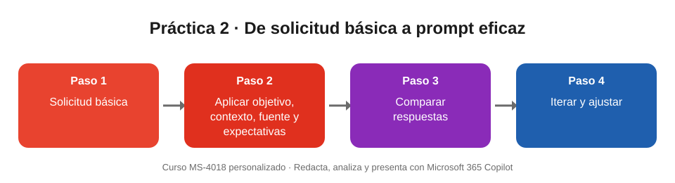

# Práctica 2. De una solicitud básica a un prompt eficaz

## Objetivo de la práctica:
Al finalizar la práctica, serás capaz de:
- Identificar los cuatro elementos de un prompt eficaz: objetivo, contexto, fuente y expectativas.
- Convertir una solicitud básica en un prompt estructurado para resumir información o elaborar una propuesta laboral.
- Iterar sobre una respuesta de Copilot en la misma conversación, sin empezar de cero.

## Objetivo Visual


## Duración aproximada:
- 8 minutos.

## Tabla de ayuda:
| Recurso | Valor |
| --- | --- |
| Copilot Chat (web) | https://m365.cloud.microsoft |
| Cuenta | Tu cuenta de trabajo de Microsoft 365 |
| Marco de cuatro elementos | Contexto · Objetivo · Fuente · Expectativas |
| Datos de la práctica | Ficticios, incluidos en esta guía |

## Instrucciones
### Tarea 1. Probar una solicitud básica.
Paso 1. Abrir Microsoft 365 Copilot Chat con la cuenta de trabajo.

Paso 2. Escribir y enviar la siguiente solicitud básica:

```
Hazme una propuesta para mejorar la atención.
```

Paso 3. Observar la respuesta y anotar qué le falta: ¿sabe de qué área hablas, para quién es, con qué datos y en qué formato la necesitas?

### Tarea 2. Escribir un prompt estructurado.
Paso 1. Abrir un chat nuevo.

Paso 2. Escribir y enviar el prompt estructurado (puedes adaptarlo con datos ficticios de tu propia área):

```
Actúa como analista de procesos.
Objetivo: proponer 3 mejoras para reducir el tiempo de espera en la atención presencial.
Contexto: la sucursal atiende 120 clientes al día y la espera promedio es de 25 minutos.
Fuente: usa solo los datos que te doy.
Expectativas: tabla con mejora, beneficio, esfuerzo y primer paso; máximo 150 palabras; tono profesional.
```

Paso 3. Comparar la respuesta con la de la Tarea 1: formato, precisión y cuánto tendrías que corregir.

Paso 4. Pedir un ajuste en la misma conversación:

```
Adáptalo como un mensaje breve para la gerencia, en 5 líneas.
```

### Tarea 3 (variante). Resumir información con el mismo marco.
Paso 1. Copiar el siguiente correo ficticio:

```
Asunto: Seguimiento comité de servicio – octubre
Hola equipo: en el comité de ayer revisamos los resultados del trimestre. La satisfacción bajó de 86 % a 81 % y el principal motivo de queja es el tiempo de espera en caja. Se acordó: (1) abrir una ventanilla adicional los lunes y viernes desde el 3 de noviembre, a cargo de Operaciones; (2) que Marta prepare una encuesta corta para la salida de la sucursal antes del 10 de noviembre; (3) revisar el resultado en el comité del 28 de noviembre. Queda pendiente confirmar el presupuesto de la ventanilla adicional con Finanzas.
Saludos, Jorge
```

Paso 2. Escribir y enviar el prompt:

```
Contexto: soy líder del área de servicio y debo informar a mi equipo.
Objetivo: resume el siguiente correo.
Fuente: usa solo el texto del correo, sin agregar información.
Expectativas: 3 viñetas con los acuerdos (responsable y fecha) y 1 línea con lo pendiente.
[pegar aquí el correo]
```

Paso 3. Validar que cada acuerdo tiene el responsable y la fecha correctos según el correo original.

### Resultado esperado
- La respuesta del prompt estructurado viene en una **tabla** con 3 mejoras y las columnas mejora, beneficio, esfuerzo y primer paso, con unas 150 palabras como máximo.
- No aparecen datos que no hayas entregado (por ejemplo, costos o porcentajes inventados).
- En la variante, el resumen incluye exactamente:
  - Ventanilla adicional lunes y viernes desde el 3 de noviembre — Operaciones.
  - Encuesta corta de salida antes del 10 de noviembre — Marta.
  - Revisión en el comité del 28 de noviembre.
  - Pendiente: confirmar el presupuesto de la ventanilla con Finanzas.
