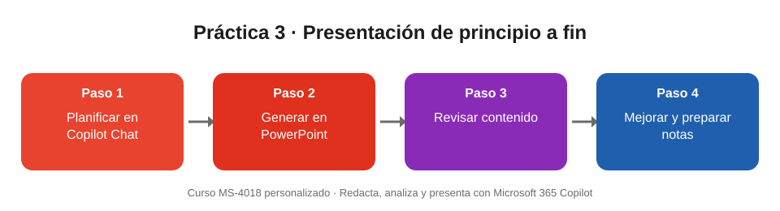

# Práctica 3. Crear una presentación de principio a fin con Copilot

## Objetivo de la práctica:
Al finalizar la práctica, serás capaz de:
- Planificar la narrativa de una presentación con Copilot Chat antes de crear las diapositivas.
- Generar una presentación en PowerPoint con Copilot a partir de un esquema.
- Revisar y mejorar el contenido con las opciones de reescritura y generar notas del orador.

## Objetivo Visual


## Duración aproximada:
- 15 minutos.

## Tabla de ayuda:
| Recurso | Valor |
| --- | --- |
| Copilot Chat (web) | https://m365.cloud.microsoft |
| Aplicación | PowerPoint (escritorio o web) con Copilot habilitado |
| Almacenamiento | OneDrive o SharePoint de tu cuenta de trabajo |
| Escenario | Plan de 6 diapositivas para mejorar la experiencia del cliente en sucursal (ficticio) |

## Instrucciones
### Tarea 1. Planificar la presentación.
Paso 1. Abrir Microsoft 365 Copilot Chat.

Paso 2. Escribir y enviar el prompt de planificación:

```
Ayúdame a planificar una presentación de 6 diapositivas para el comité de gerencia sobre cómo mejorar la experiencia del cliente en sucursal. Propón título, un mensaje clave por diapositiva y un cierre con 3 decisiones que el comité debe tomar.
```

Paso 3. Revisar el esquema y pedir un ajuste si algo no convence, por ejemplo:

```
Cambia la diapositiva 4 para que hable de indicadores de seguimiento.
```

Paso 4. Copiar el esquema final.

### Tarea 2. Generar la presentación en PowerPoint.
Paso 1. Abrir PowerPoint y crear una presentación en blanco guardada en OneDrive.

Paso 2. Seleccionar **Copilot** en la cinta de opciones.

Paso 3. Escribir y enviar el prompt de creación:

```
Crea una presentación con este esquema: [pegar el esquema]. Público: comité de gerencia. Tono ejecutivo y claro.
```

Paso 4. Responder las preguntas aclaratorias que haga Copilot, si las hay, y esperar a que genere las diapositivas.

### Tarea 3. Revisar y mejorar.
Paso 1. Leer cada diapositiva y comprobar que el orden sigue el esquema.

Paso 2. Corregir o eliminar cualquier cifra o dato que Copilot haya inventado.

Paso 3. Seleccionar un cuadro de texto, usar el botón de opciones de reescritura y elegir **Condensa**.

Paso 4. Pedir en el panel de Copilot:

```
Agrega una diapositiva de próximos pasos con responsables.
```

Paso 5. Pedir en el panel de Copilot:

```
Genera notas del orador para todas las diapositivas.
```

> Si no tienes Copilot habilitado dentro de PowerPoint, realiza la Tarea 1 en Copilot Chat y pídele el contenido diapositiva por diapositiva para copiarlo manualmente.

### Resultado esperado
- Una presentación de unas 7 diapositivas (6 del esquema más la de próximos pasos) sobre la mejora de la experiencia del cliente.
- Cada diapositiva tiene un mensaje clave claro y el cierre presenta 3 decisiones para el comité.
- Ningún dato o cifra aparece sin fuente: lo que Copilot inventó fue corregido o eliminado.
- Al menos una diapositiva fue condensada con la reescritura y todas tienen notas del orador.
