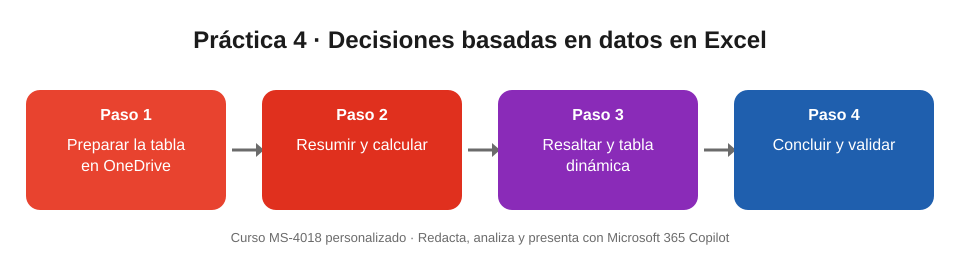

# Práctica 4. Mejora tu productividad con decisiones basadas en datos en Excel

## Objetivo de la práctica:
Al finalizar la práctica, serás capaz de:
- Preparar un libro de Excel para que Copilot lo analice correctamente.
- Pedir a Copilot resúmenes, columnas calculadas, formato condicional y tablas dinámicas en lenguaje natural.
- Redactar conclusiones a partir de los datos y validarlas antes de compartirlas.

## Objetivo Visual


## Duración aproximada:
- 15 minutos.

## Tabla de ayuda:
| Recurso | Valor |
| --- | --- |
| Archivo de la práctica | [Ejercicio3_Indicadores_Sucursales.xlsx](Ejercicio3_Indicadores_Sucursales.xlsx) (datos ficticios) |
| Contenido | Tabla **Indicadores**: 6 sucursales × 3 meses (enero a marzo) |
| Columnas | Mes, Sucursal, Región, Meta, Ventas, Clientes nuevos, Satisfacción (%), Solicitudes pendientes |
| Requisito | Guardar el libro en OneDrive o SharePoint para habilitar Copilot |

## Instrucciones
### Tarea 1. Preparar el libro.
Paso 1. Descargar el archivo **Ejercicio3_Indicadores_Sucursales.xlsx**.

Paso 2. Subirlo a OneDrive de la cuenta de trabajo y abrirlo en Excel.

Paso 3. Comprobar que los datos están en formato de tabla (pestaña **Diseño de tabla** al seleccionar una celda).

Paso 4. Seleccionar **Copilot** en la pestaña **Inicio**.

### Tarea 2. Explorar y calcular con Copilot.
Paso 1. Escribir y enviar:

```
Resume las tendencias principales de esta tabla por sucursal.
```

Paso 2. Escribir y enviar:

```
Agrega una columna con el porcentaje de cumplimiento (Ventas / Meta).
```

Paso 3. Revisar la fórmula propuesta antes de insertarla y aplicar la columna.

Paso 4. Escribir y enviar:

```
Resalta las filas con cumplimiento menor al 90 %.
```

### Tarea 3. Resumir y concluir.
Paso 1. Escribir y enviar:

```
Crea una tabla dinámica con el cumplimiento promedio por región y mes.
```

Paso 2. Escribir y enviar:

```
Con base en estos datos, redacta 3 conclusiones y 2 acciones. No inventes datos.
```

Paso 3. Validar a mano al menos dos cifras de las conclusiones (por ejemplo, el cumplimiento de Puerto Azul en marzo: 94 / 110).

Paso 4. Responder la pregunta de negocio: ¿qué sucursal necesita atención y por qué?

> Si no tienes Copilot disponible en Excel, carga el archivo en Copilot Chat con el botón **+** y hazle las mismas preguntas.

### Resultado esperado
Cumplimiento (Ventas / Meta) por sucursal:

| Sucursal | Región | Enero | Febrero | Marzo | Promedio |
| --- | --- | --- | --- | --- | --- |
| Centro | Norte | 98,3 % | 103,3 % | 100,8 % | 100,8 % |
| Parque Real | Norte | 95,0 % | 91,0 % | **88,0 %** | 91,3 % |
| Los Álamos | Sur | 102,2 % | 105,6 % | 107,8 % | 105,2 % |
| Puerto Azul | Sur | **87,3 %** | **89,1 %** | **85,5 %** | 87,3 % |
| Mirador | Occidente | 101,2 % | 98,8 % | 103,8 % | 101,3 % |
| San Gabriel | Occidente | **89,5 %** | 94,7 % | 97,9 % | 94,0 % |

En negrita, las 5 filas por debajo del 90 % que Copilot debe resaltar.

Conclusiones esperadas:
- **Puerto Azul** necesita atención prioritaria: no alcanza el 90 % en ningún mes, tiene la satisfacción más baja (76 % en marzo) y las solicitudes pendientes van en aumento (14, 15 y 17).
- **Parque Real** muestra una tendencia negativa sostenida: el cumplimiento baja de 95 % a 88 % y la satisfacción de 84 % a 80 %.
- **San Gabriel** se recupera: pasa de 89,5 % a 97,9 % y reduce sus pendientes de 10 a 7.
- Por región y mes, el único promedio que llega al 100 % es Occidente en marzo (100,8 %).
