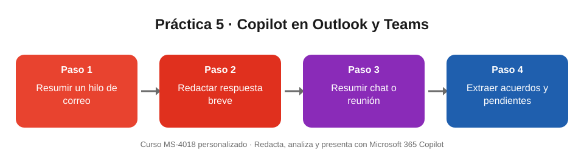

# Práctica 5. Copilot en Outlook y Teams

## Objetivo de la práctica:
Al finalizar la práctica, serás capaz de:
- Resumir un hilo de correos en Outlook e identificar decisiones, pendientes y responsables.
- Redactar y ajustar una respuesta breve con Borrador con Copilot.
- Resumir una conversación o reunión de Teams y extraer acuerdos y pendientes.

## Objetivo Visual


## Duración aproximada:
- 12 minutos (en la sesión, el instructor la realiza como demostración; repítela luego en tu propio buzón).

## Tabla de ayuda:
| Recurso | Valor |
| --- | --- |
| Aplicaciones | Outlook (nuevo Outlook o Outlook en la web) y Microsoft Teams |
| Licencia | Las funciones sobre tus correos, chats y reuniones requieren Microsoft 365 Copilot |
| Reuniones | El resumen requiere grabación o transcripción, o Copilot habilitado durante la reunión |
| Material | Un hilo de correo largo y un chat o reunión propios, sin información confidencial |

## Instrucciones
### Tarea 1. Resumir un hilo de correo en Outlook.
Paso 1. Abrir Outlook y seleccionar un hilo de correo con varias respuestas.

Paso 2. Seleccionar **Resumen por Copilot** en la parte superior del mensaje.

Paso 3. Abrir Copilot y pedir un resumen más preciso:

```
Resume este hilo en 5 viñetas: decisiones, pendientes y responsables.
```

Paso 4. Seleccionar una de las referencias numeradas para comprobar el dato en el correo original.

### Tarea 2. Redactar una respuesta breve.
Paso 1. Seleccionar **Responder** y luego **Borrador con Copilot**.

Paso 2. Escribir la instrucción:

```
Redacta una respuesta breve que agradezca la información, confirme los acuerdos y proponga una fecha para el siguiente paso.
```

Paso 3. Ajustar el resultado:

```
Hazlo más conciso y con un tono cordial.
```

Paso 4. Revisar nombres, fechas y compromisos antes de decidir si se envía. **No enviar el correo durante la práctica** si no corresponde a una conversación real.

### Tarea 3. Resumir una conversación de Teams.
Paso 1. Abrir Teams y entrar en un chat o canal con actividad reciente.

Paso 2. Abrir Copilot en el chat y escribir:

```
Resume lo más importante de esta conversación de los últimos 7 días.
```

Paso 3. Escribir:

```
¿Qué acuerdos se tomaron y qué quedó pendiente? Preséntalo en una tabla con responsable y fecha.
```

Paso 4. Escribir:

```
¿Hay preguntas sin responder en este chat?
```

Paso 5. Si tienes una reunión grabada o transcrita, abrir su chat, seleccionar la pestaña **Resumen** y revisar el **Resumen inteligente**: notas, tareas de seguimiento y transcripción.

### Resultado esperado
- Un resumen del hilo de correo en 5 viñetas, con al menos una referencia verificada en el correo original.
- Un borrador de respuesta breve y cordial, revisado por ti y sin enviar automáticamente.
- Una tabla de acuerdos y pendientes de Teams con responsable y fecha; si la conversación no menciona una fecha, la celda queda vacía o indicada como «por definir», sin fechas inventadas.
