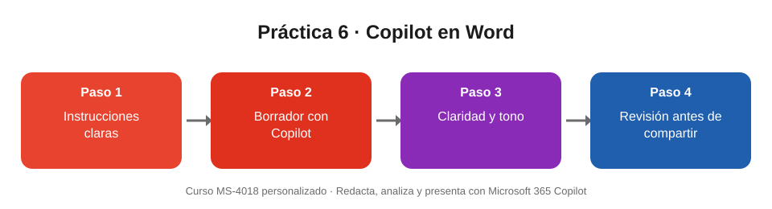

# Práctica 6. Redactar y mejorar un comunicado con Copilot en Word

## Objetivo de la práctica:
Al finalizar la práctica, serás capaz de:
- Generar un borrador de comunicado o informe breve en Word a partir de instrucciones claras.
- Mejorar la claridad y el tono del texto con la reescritura automática y los prompts de mejora.
- Revisar el resultado antes de compartirlo.

## Objetivo Visual


## Duración aproximada:
- 12 minutos (en la sesión, el instructor la realiza como demostración; repítela luego por tu cuenta).

## Tabla de ayuda:
| Recurso | Valor |
| --- | --- |
| Aplicación | Word (escritorio o web) con Copilot habilitado |
| Almacenamiento | OneDrive o SharePoint de tu cuenta de trabajo |
| Escenario | Comunicado interno sobre el nuevo horario de atención de la sucursal (ficticio) |
| Puntos de entrada | **Borrador con Copilot** en el documento · panel de **Copilot** en la pestaña Inicio |

## Instrucciones
### Tarea 1. Generar el borrador.
Paso 1. Abrir Word y crear un documento en blanco.

Paso 2. Seleccionar **Borrador con Copilot**.

Paso 3. Escribir y enviar:

```
Redacta un comunicado interno de máximo 250 palabras para el personal de la sucursal sobre el nuevo horario de atención desde el 1 de noviembre, de 8:00 a 17:00. Incluye el motivo, qué cambia para los clientes y a quién consultar. Tono cercano y profesional.
```

Paso 4. Seleccionar **Conservar** cuando el borrador cumpla con lo pedido.

### Tarea 2. Mejorar claridad y tono.
Paso 1. Pedir a Copilot:

```
Hazlo más conciso.
```

Paso 2. Pedir a Copilot:

```
Agrega una tabla con el horario anterior y el nuevo.
```

Paso 3. Seleccionar un párrafo, usar la **reescritura automática** y comparar las versiones propuestas antes de elegir una.

### Tarea 3. Revisar antes de compartir.
Paso 1. Abrir el panel de Copilot y escribir:

```
Revisa la claridad de este documento y sugiere mejoras.
```

Paso 2. Comprobar a mano fechas, horarios, nombres y el contacto de consulta.

Paso 3. Reemplazar cualquier dato que Copilot haya supuesto (por ejemplo, el horario anterior o el nombre del responsable) por el dato real o marcarlo como pendiente.

### Resultado esperado
- Un comunicado de 250 palabras o menos, con motivo, cambios para los clientes y contacto de consulta.
- Una tabla con el horario anterior y el nuevo (8:00 a 17:00 desde el 1 de noviembre).
- Ningún dato supuesto queda sin revisar: los que no te dieron se reemplazan o se marcan como pendientes.
