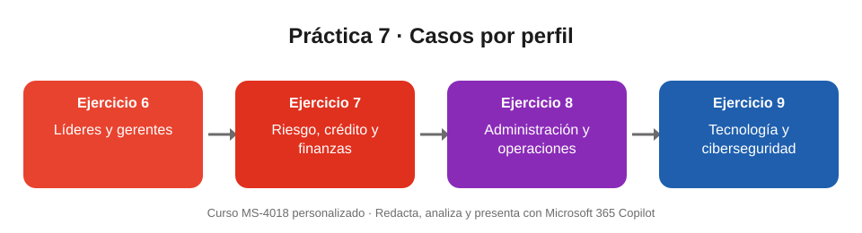

# Práctica 7. Casos por perfil

## Objetivo de la práctica:
Al finalizar la práctica, serás capaz de:
- Aplicar prompts estructurados a situaciones típicas de tu perfil de trabajo.
- Incluir restricciones en el prompt para evitar datos inventados, decisiones o afirmaciones no sustentadas.
- Validar la respuesta de Copilot antes de usarla.

## Objetivo Visual


## Duración aproximada:
- 25 minutos (Ejercicio 6: 6 min · Ejercicio 7: 7 min · Ejercicio 8: 6 min · Ejercicio 9: 6 min).

## Tabla de ayuda:
| Recurso | Valor |
| --- | --- |
| Copilot Chat (web) | https://m365.cloud.microsoft |
| Cuenta | Tu cuenta de trabajo de Microsoft 365 |
| Datos | Todos los datos son **ficticios**; no uses información real de clientes |
| Pasos comunes | Copiar el prompt · revisar que use solo los datos dados · pedir un ajuste · validar |

## Instrucciones
### Tarea 1. Ejercicio 6 · Líderes de área y gerentes de sucursal: resumen de indicadores y acciones prioritarias.
Paso 1. Abrir Copilot Chat y enviar el prompt:

```
Actúa como apoyo a la gestión de una sucursal. Con base en estos indicadores ficticios: meta mensual 100, resultado 88, satisfacción 82% y 12 solicitudes pendientes, redacta un resumen ejecutivo de 5 líneas, identifica 2 prioridades y propone 2 acciones concretas. No inventes datos.
```

Paso 2. Revisar que el resumen use solo los cuatro datos entregados.

Paso 3. Pedir un ajuste: `Adáptalo como un mensaje breve para el equipo de la sucursal.`

Paso 4. Validar que las acciones sean concretas y realistas; si son genéricas, pedir que las haga más específicas.

### Tarea 2. Ejercicio 7 · Analistas de riesgo, crédito, finanzas y datos: lectura inicial de variaciones.
Paso 1. Enviar el prompt:

```
Analiza estos datos de ejemplo: cartera vencida enero 4,2%, febrero 4,8% y marzo 5,1%; solicitudes aprobadas 75, 72 y 69. Calcula las variaciones, presenta una tabla breve y señala 2 preguntas que conviene investigar. No emitas una decisión crediticia ni supongas causas.
```

Paso 2. Verificar los cálculos con la tabla del resultado esperado.

Paso 3. Comprobar que Copilot no mezcla puntos porcentuales con variación porcentual; si lo hace, pedir la corrección.

Paso 4. Confirmar que la respuesta no emite una decisión crediticia ni atribuye causas.

### Tarea 3. Ejercicio 8 · Áreas administrativas y de operaciones: organización y seguimiento.
Paso 1. Enviar el prompt:

```
Organiza estas tareas de ejemplo: validar 8 facturas, responder 5 solicitudes y actualizar el informe semanal. Crea una tabla con tarea, prioridad sugerida, siguiente paso y evidencia de cierre. Indica qué información falta para confirmar las prioridades.
```

Paso 2. Revisar que la tabla incluya las tres tareas y las cuatro columnas.

Paso 3. Leer la lista de información faltante (por ejemplo, fechas de vencimiento o impacto de cada tarea).

Paso 4. Pedir un ajuste: `Conviértelo en una lista de verificación para esta semana.`

### Tarea 4. Ejercicio 9 · Tecnología y ciberseguridad: comunicación de una incidencia.
Paso 1. Enviar el prompt:

```
Con estos datos ficticios: alerta de inicio de sesión inusual a las 09:10, cuenta afectada usuario01 y revisión en curso, redacta un reporte inicial para el equipo de TI con hechos confirmados, datos por verificar, 3 pasos sugeridos de revisión y un aviso breve al responsable. No declares que hubo una intrusión.
```

Paso 2. Comprobar que el reporte separa los hechos confirmados de los datos por verificar.

Paso 3. Confirmar que en ningún punto se afirma que hubo una intrusión.

Paso 4. Pedir un ajuste: `Escribe una versión del aviso para un público no técnico.`

### Resultado esperado
**Ejercicio 6.** Un resumen de 5 líneas que menciona solo meta 100, resultado 88 (88 % de cumplimiento), satisfacción 82 % y 12 solicitudes pendientes; 2 prioridades y 2 acciones concretas.

**Ejercicio 7.** Variaciones correctas:

| Indicador | Enero → Febrero | Febrero → Marzo |
| --- | --- | --- |
| Cartera vencida | +0,6 puntos porcentuales (4,2 % → 4,8 %) | +0,3 puntos porcentuales (4,8 % → 5,1 %) |
| Solicitudes aprobadas | −3 (−4,0 %) | −3 (−4,2 %) |

Más 2 preguntas para investigar, sin decisión crediticia ni causas supuestas.

**Ejercicio 8.** Una tabla con las 3 tareas (8 facturas, 5 solicitudes, informe semanal), su prioridad sugerida, siguiente paso y evidencia de cierre, y una lista de la información que falta para confirmar prioridades.

**Ejercicio 9.** Un reporte con:
- Hechos confirmados: alerta de inicio de sesión inusual a las 09:10 y cuenta afectada usuario01.
- Datos por verificar: origen del acceso, legitimidad del inicio de sesión y alcance.
- 3 pasos sugeridos de revisión y un aviso breve al responsable.
- Ninguna afirmación de que hubo una intrusión.
