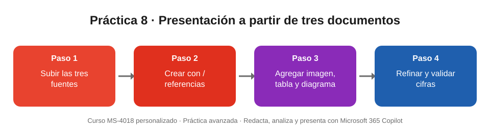

# Práctica 8 (avanzada). Crear una presentación a partir de tres documentos

## Objetivo de la práctica:
Al finalizar la práctica, serás capaz de:
- Crear una presentación en PowerPoint con Copilot combinando varias fuentes de información.
- Agregar contenido visual (imagen, tabla y diagrama) mediante prompts.
- Revisar las cifras de la presentación contra los documentos originales antes de compartirla.

## Objetivo Visual


## Duración aproximada:
- 15 minutos.

## Tabla de ayuda:
| Recurso | Valor |
| --- | --- |
| Archivos base | [01_Informe_Resultados_Q3_2026.docx](01_Informe_Resultados_Q3_2026.docx) · [02_Encuesta_Experiencia_Cliente_2026.docx](02_Encuesta_Experiencia_Cliente_2026.docx) · [03_Propuesta_Plan_Sucursal_Agil_2027.docx](03_Propuesta_Plan_Sucursal_Agil_2027.docx) |
| Escenario | Banco Meridiano (entidad ficticia): resultados de la red de sucursales, encuesta de clientes y plan «Sucursal Ágil» |
| Aplicación | PowerPoint (escritorio o web) con Microsoft 365 Copilot |
| Requisitos | Licencia de Microsoft 365 Copilot; archivos guardados en OneDrive. PowerPoint admite hasta cinco archivos de referencia por solicitud |

## Instrucciones
### Tarea 1. Preparar los archivos.
Paso 1. Descargar los tres documentos de esta carpeta.

Paso 2. Subirlos a una carpeta de OneDrive, por ejemplo **Practicas_MS4018**.

Paso 3. Abrir cada documento una vez desde OneDrive para revisar qué aporta: el **informe** trae los indicadores, la **encuesta** la voz del cliente y la **propuesta** la solución y la inversión.

### Tarea 2. Crear la presentación con las tres fuentes.
Paso 1. Abrir PowerPoint y crear una presentación en blanco.

Paso 2. Seleccionar **Copilot** en la cinta de opciones.

Paso 3. Escribir el prompt. Al teclear **/** aparece el buscador de archivos: seleccionar cada documento.

```
Crea una presentación de 8 diapositivas para el comité de gerencia de Banco Meridiano usando estos tres documentos: /01_Informe_Resultados_Q3_2026, /02_Encuesta_Experiencia_Cliente_2026 y /03_Propuesta_Plan_Sucursal_Agil_2027. Estructura: 1) título; 2) situación actual con los indicadores clave; 3) qué nos dicen los clientes; 4) dónde se concentra el problema; 5) el plan Sucursal Ágil y sus cuatro iniciativas; 6) inversión y calendario; 7) metas para 2027; 8) decisiones que pedimos al comité. Tono ejecutivo, frases cortas y usa solo cifras que aparezcan en los documentos.
```

Paso 4. Responder las preguntas aclaratorias de Copilot si las hay, elegir una plantilla y generar.

### Tarea 3. Agregar contenido visual.
Paso 1. En el panel de Copilot, pedir una imagen:

```
Crea una imagen fotorrealista de una sucursal bancaria moderna donde una asesora ayuda a un cliente mayor a usar el turno digital en su teléfono, con un kiosco de autoservicio al fondo, luz natural cálida y estilo corporativo. Agrégala a la diapositiva del plan Sucursal Ágil.
```

Paso 2. Pedir una tabla comparativa:

```
Agrega una diapositiva con una tabla que compare, por sucursal, el tiempo de espera promedio, el NPS y los reclamos del tercer trimestre, según /01_Informe_Resultados_Q3_2026. Resalta Puerto Azul y Parque Real.
```

Paso 3. Pedir un diagrama:

```
Convierte las cuatro iniciativas del plan en un diagrama visual de cuatro pasos con un icono para cada una.
```

Paso 4. Seleccionar una diapositiva y abrir **Inicio > Diseñador** para aplicar una sugerencia de diseño.

> Si la imagen o el diagrama no se generan en tu versión, usa **Diseñador** sobre la diapositiva o inserta un icono desde **Insertar > Iconos**.

### Tarea 4. Refinar y revisar.
Paso 1. Pedir a Copilot:

```
Condensa la diapositiva 3 en tres viñetas de máximo 12 palabras cada una.
```

Paso 2. Pedir a Copilot:

```
Genera notas del orador para todas las diapositivas, de unas 80 palabras cada una.
```

Paso 3. Comparar las cifras de la presentación con la tabla del resultado esperado y corregir cualquier dato que no coincida.

### Resultado esperado
Una presentación de unas 9 diapositivas (8 más la tabla comparativa) con una imagen, una tabla, un diagrama de cuatro pasos y notas del orador. Las cifras deben coincidir con los documentos:

| Dato | Valor correcto | Fuente |
| --- | --- | --- |
| Clientes atendidos en Q3 | 66.120 | Informe |
| Espera promedio de la red | 21 minutos (antes 19) | Informe |
| NPS de la red | 38 (antes 41) | Informe |
| Reclamos del trimestre | 283; 55 % en Puerto Azul y Parque Real | Informe |
| Satisfacción con el tiempo de espera | 41 % (−11 puntos) | Encuesta |
| Canal preferido | App 46 % · Sucursal 31 % | Encuesta |
| Inversión del plan | USD 1,8 millones | Propuesta |
| Metas 2027 | Espera 12 min · NPS 50 · 170 reclamos | Propuesta |
| Piloto | Puerto Azul y Parque Real, T1 2027 | Propuesta |
