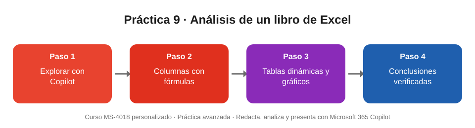

# Práctica 9 (avanzada). Analizar un libro de Excel existente: fórmulas, gráficos y conclusiones

## Objetivo de la práctica:
Al finalizar la práctica, serás capaz de:
- Explorar un libro de Excel con Copilot y plantear preguntas de negocio sobre los datos.
- Agregar columnas calculadas con fórmulas y aplicar formato condicional en lenguaje natural.
- Crear tablas dinámicas y gráficos, y redactar conclusiones verificables.

## Objetivo Visual


## Duración aproximada:
- 15 minutos.

## Tabla de ayuda:
| Recurso | Valor |
| --- | --- |
| Archivo base | [Demo_Excel_Resultados_2026.xlsx](Demo_Excel_Resultados_2026.xlsx) (datos ficticios) |
| Contenido | Hoja **Resultados_2026**, tabla **Resultados** con 720 filas: 12 meses × 6 sucursales × 5 productos × 2 canales |
| Columnas | Fecha, Sucursal, Región, Producto, Canal, Operaciones, Ingresos (USD), Costo operativo (USD), Meta de ingresos (USD), Reclamos |
| Requisitos | Licencia de Microsoft 365 Copilot; libro guardado en OneDrive. Usar **Editar con Copilot** para que aplique los cambios en el libro |

## Instrucciones
### Tarea 1. Abrir y explorar.
Paso 1. Descargar el libro, subirlo a OneDrive y abrirlo en Excel.

Paso 2. Abrir **Copilot** en la pestaña Inicio. Si aparece el mensaje de edición conjunta, aceptarlo; si no, elegir **Editar con Copilot** en el menú de herramientas del panel.

Paso 3. Escribir:

```
Describe qué contiene esta tabla y propón cinco preguntas de negocio que podríamos responder con estos datos.
```

### Tarea 2. Agregar columnas con fórmulas.
Paso 1. Escribir:

```
Agrega a la tabla una columna «Margen (USD)» que reste el Costo operativo a los Ingresos, y otra columna «% Margen» que divida el Margen entre los Ingresos, con formato de porcentaje.
```

Paso 2. Escribir:

```
Agrega una columna «% Cumplimiento» que divida los Ingresos entre la Meta de ingresos, con formato de porcentaje, y una columna «Trimestre» con los valores T1, T2, T3 o T4 según la Fecha.
```

Paso 3. Hacer clic en una celda de las columnas nuevas y revisar la fórmula en la barra. Debe usar referencias estructuradas, por ejemplo:

```
=[@[Ingresos (USD)]]-[@[Costo operativo (USD)]]
=[@[Margen (USD)]]/[@[Ingresos (USD)]]
```

Paso 4. Escribir:

```
Aplica formato condicional para resaltar en rojo claro las filas con % Cumplimiento menor al 85 %.
```

### Tarea 3. Crear tablas dinámicas y gráficos.
Paso 1. Escribir:

```
Crea en una hoja nueva una tabla dinámica con el % de cumplimiento por sucursal y trimestre, y un gráfico de líneas a partir de ella.
```

Paso 2. Escribir:

```
Crea un gráfico de columnas agrupadas con los ingresos totales por región, separados por canal (Sucursal y Digital).
```

Paso 3. Escribir:

```
Crea un gráfico de líneas con el porcentaje de operaciones del canal Digital por mes durante 2026.
```

> Si un gráfico no queda como esperabas, pide el ajuste en lenguaje natural («cambia a columnas apiladas», «agrega títulos de eje») o créalo desde la tabla dinámica con **Insertar > Gráficos recomendados**.

### Tarea 4. Obtener conclusiones.
Paso 1. Escribir:

```
¿Qué sucursal empeora su % de cumplimiento a lo largo del año y cuál mejora? Muestra los valores por trimestre.
```

Paso 2. Escribir:

```
Crea una hoja llamada «Conclusiones» con tres conclusiones y tres recomendaciones para el comité, cada una con la cifra que la respalda. Usa solo los datos del libro y no inventes información.
```

Paso 3. Validar a mano al menos dos cifras de las conclusiones con la tabla del resultado esperado.

### Resultado esperado
Valores calculados sobre el archivo entregado (pueden variar en décimas por redondeo):

| Pregunta | Resultado esperado |
| --- | --- |
| Ingresos totales 2026 | USD 1.585.002 · margen 56,6 % · cumplimiento 95,1 % |
| Sucursal que empeora | Parque Real: 94,6 % (T1) → 88,4 % → 84,7 % → 80,1 % (T4) |
| Sucursal que mejora | San Gabriel: 96,2 % (T1) → 99,7 % → 105,7 % → 109,7 % (T4) |
| Menor margen y más reclamos | Puerto Azul: margen 50,7 % y 137 reclamos |
| Producto con mayor margen | Seguro de vida: 73,4 % |
| Canal con mayor margen | Digital 63,4 % frente a Sucursal 51,4 % |
| Peso del canal Digital (operaciones) | Enero 35,0 % · Junio 42,5 % · Diciembre 52,1 % |
| Ingresos por región | Norte USD 590.834 · Sur USD 543.330 · Occidente USD 450.837 |
