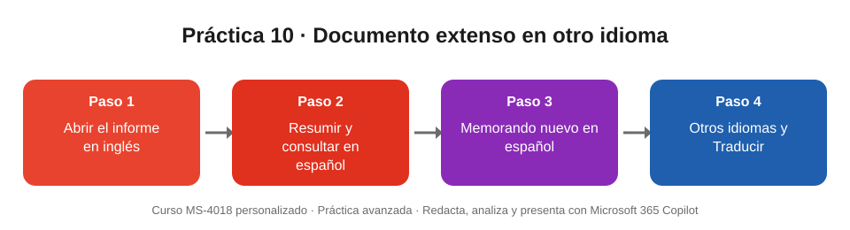

# Práctica 10 (avanzada). Resumir un documento extenso en otro idioma con Copilot en Word

## Objetivo de la práctica:
Al finalizar la práctica, serás capaz de:
- Resumir y consultar en español un documento extenso escrito en inglés.
- Crear un documento nuevo en español a partir de una fuente en otro idioma.
- Diferenciar el trabajo de Copilot (entender y reescribir) de la función Traducir de Word (traducción literal).

## Objetivo Visual


## Duración aproximada:
- 15 minutos.

## Tabla de ayuda:
| Recurso | Valor |
| --- | --- |
| Archivo base | [Annual_Report_CX_Digital_2026_EN.docx](Annual_Report_CX_Digital_2026_EN.docx): informe anual en inglés, unas 9 páginas, con tablas y anexos (datos ficticios) |
| Aplicación | Word (escritorio o web) con Microsoft 365 Copilot |
| Requisitos | Licencia de Microsoft 365 Copilot; archivo guardado en OneDrive |
| Idioma | Copilot responde en el idioma en que escribes el prompt |

## Instrucciones
### Tarea 1. Abrir el documento.
Paso 1. Descargar el informe, subirlo a OneDrive y abrirlo en Word.

Paso 2. Recorrer rápidamente las secciones. Si Word muestra el **resumen automático** en la parte superior, revisarlo.

### Tarea 2. Resumir y consultar en español.
Paso 1. Abrir el panel de **Copilot** (pestaña Inicio) y escribir:

```
Resume este documento en español en siete viñetas para el comité de gerencia, incluyendo las cifras clave.
```

Paso 2. Escribir:

```
¿Cuáles son las cuatro prioridades estratégicas para 2027 y cuánto cuesta el plan «Agile Branch»? Responde en español e indica en qué sección del documento aparece cada dato.
```

Paso 3. Escribir:

```
Crea una tabla en español con los indicadores de experiencia del cliente: indicador, valor anterior, valor actual y variación.
```

Paso 4. Escribir:

```
Explica en español y en lenguaje sencillo qué es el NPS y por qué bajó tanto en la sucursal Puerto Azul.
```

> Si alguna respuesta sale en inglés, agrega al final del prompt: «Responde siempre en español».

### Tarea 3. Crear un memorando en español.
Paso 1. Crear un documento de Word en blanco y seleccionar **Borrador con Copilot**.

Paso 2. Escribir el prompt y referenciar el informe con **/**:

```
Redacta en español un memorando de una página para la junta directiva basado en /Annual_Report_CX_Digital_2026_EN, con estas secciones: contexto, tres hallazgos principales con cifras, las cuatro prioridades para 2027 y la decisión que se solicita. Tono formal y frases cortas.
```

Paso 3. Pedir:

```
Agrega al final una tabla con la inversión 2027 por iniciativa, en dólares, traducida al español.
```

### Tarea 4. Explorar otros idiomas.
Paso 1. Pedir:

```
Escribe una versión en inglés del primer párrafo del memorando para el equipo regional.
```

Paso 2. Pedir:

```
Resume el memorando en portugués de Brasil en cinco líneas para el equipo de São Paulo.
```

Paso 3. Volver al informe original y probar **Revisar > Traducir > Traducir documento** para obtener una copia traducida completa. Comparar ese resultado con lo que hizo Copilot.

### Resultado esperado
Respuestas en español que contienen estos datos del informe:

| Dato | Valor en el informe |
| --- | --- |
| NPS de la red | Bajó de 41 a 38 puntos (Q2 → Q3 2026) |
| Tiempo de espera | Subió de 19 a 21 minutos |
| Satisfacción con la espera | 41 %, once puntos menos que en 2025 |
| Operaciones digitales | De 35 % en enero a 52 % en diciembre |
| Margen por canal | Digital 63,4 % frente a Sucursal 51,4 % |
| Puerto Azul | NPS 18 (−9), espera 31 min, tres vacantes de cajero durante seis semanas |
| Piloto de Copilot | 150 empleados, 3,5 horas ahorradas por semana; expansión a 1.200 empleados en 2027 |
| Plan Agile Branch | USD 1,8 millones, retorno en 26 meses, piloto en Puerto Azul y Parque Real |
| Cuatro prioridades 2027 | Agile Branch · migración digital asistida · fuente única de información de productos · IA responsable a escala |

Además, un memorando de una página en español con la tabla de inversión, y sus versiones parciales en inglés y portugués.
