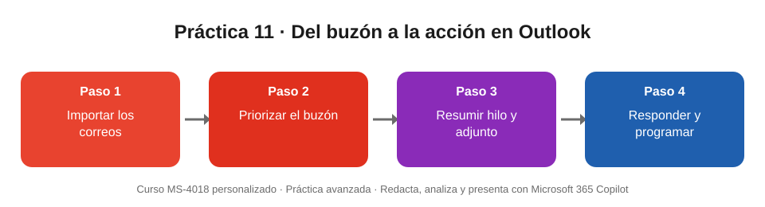

# Práctica 11 (avanzada). Del buzón a la acción con Copilot en Outlook

## Objetivo de la práctica:
Al finalizar la práctica, serás capaz de:
- Priorizar los correos que requieren tu acción con Copilot.
- Resumir un hilo largo y su archivo adjunto, separando decisiones, pendientes y desacuerdos.
- Redactar y mejorar una respuesta, y convertir el hilo en una reunión con Copilot.

## Objetivo Visual


## Duración aproximada:
- 15 minutos.

## Tabla de ayuda:
| Recurso | Valor |
| --- | --- |
| Archivos base | Nueve correos ficticios en formato .eml (seis forman el hilo «Piloto Sucursal Ágil»; el primero trae un adjunto) y la alternativa [Hilo_Piloto_Sucursal_Agil_Alternativa.docx](Hilo_Piloto_Sucursal_Agil_Alternativa.docx) |
| Tu papel | **Daniel Ortiz**, coordinador de formación de Banco Meridiano (entidad ficticia). Varios correos te piden acciones |
| Dominio de los remitentes | meridiano-demo.example (ficticio): **no envíes respuestas ni invitaciones a esas direcciones** |
| Requisitos | Licencia de Microsoft 365 Copilot; Outlook clásico para Windows u Outlook para Mac para importar los .eml |

Correos .eml de esta carpeta:

| Archivo | De | Asunto |
| --- | --- | --- |
| [01_1014_Ana.eml](01_1014_Ana.eml) | Ana Ruiz | Piloto Sucursal Ágil: arranque y preparación (con adjunto) |
| [02_1015_Carlos.eml](02_1015_Carlos.eml) | Carlos Méndez | RE: Piloto Sucursal Ágil |
| [03_1016_Jorge.eml](03_1016_Jorge.eml) | Jorge Salas | RE: Piloto Sucursal Ágil |
| [04_1016_Laura.eml](04_1016_Laura.eml) | Laura Pineda | RE: Piloto Sucursal Ágil |
| [05_1017_Marta.eml](05_1017_Marta.eml) | Marta Ríos | RE: Piloto Sucursal Ágil |
| [06_1020_Ana.eml](06_1020_Ana.eml) | Ana Ruiz | RE: Piloto Sucursal Ágil (decisiones) |
| [07_1021_Servicio.eml](07_1021_Servicio.eml) | Servicio al Cliente | Reclamo escalado: cliente de Puerto Azul |
| [08_1019_Comunicaciones.eml](08_1019_Comunicaciones.eml) | Comunicaciones Internas | Boletín interno de octubre |
| [09_1021_Sedes.eml](09_1021_Sedes.eml) | Administración de Sedes | Confirmación de reserva: Sala Andes |

## Instrucciones
### Tarea 1. Importar los correos.
Paso 1. Descargar los nueve archivos .eml.

Paso 2. En Outlook, crear una carpeta llamada **Practica MS4018** dentro de la Bandeja de entrada.

Paso 3. Arrastrar los nueve archivos a esa carpeta (funciona en Outlook clásico para Windows y en Outlook para Mac).

Paso 4. Comprobar que los seis correos «Piloto Sucursal Ágil» aparecen agrupados como una conversación.

> Si tu versión de Outlook no permite importar los .eml, sube **Hilo_Piloto_Sucursal_Agil_Alternativa.docx** a Copilot Chat y realiza allí las tareas 2 y 3.

### Tarea 2. Priorizar el buzón.
Paso 1. Abrir **Copilot** en Outlook y escribir:

```
Soy Daniel Ortiz. ¿Qué correos de la carpeta Practica MS4018 requieren una respuesta o acción mía, y para cuándo? Ordénalos por urgencia.
```

### Tarea 3. Resumir el hilo y el adjunto.
Paso 1. Abrir el hilo «Piloto Sucursal Ágil» y seleccionar **Resumen por Copilot**.

Paso 2. Escribir en el panel de Copilot:

```
Resume este hilo en tres partes: decisiones tomadas, tareas pendientes con responsable y fecha, y puntos en los que hubo desacuerdo.
```

Paso 3. Escribir:

```
Resume en cinco viñetas el documento adjunto al primer correo del hilo, con la inversión y las metas.
```

### Tarea 4. Redactar la respuesta.
Paso 1. Seleccionar **Responder a todos** en el último correo de Ana y elegir **Borrador con Copilot**.

Paso 2. Escribir:

```
Responde confirmando las sesiones de Microsoft 365 Copilot para las 32 personas del piloto: 1, 3, 9 y 11 de diciembre, de 8:00 a 10:00, en grupos de 8 personas. Pide a Marta la lista de participantes por grupo antes del 20 de noviembre y confirma mi asistencia a la reunión del martes 27. Tono cordial y profesional, máximo 120 palabras.
```

Paso 3. Seleccionar **Obtener asesoramiento** (Coaching by Copilot) y aplicar solo las sugerencias que tengan sentido.

Paso 4. **No enviar el borrador**: descartarlo al terminar.

### Tarea 5. Convertir el hilo en una reunión.
Paso 1. Con el último correo de Ana abierto, seleccionar **Programar con Copilot**.

Paso 2. Revisar el asunto, los asistentes y la agenda propuestos; ajustar la fecha al martes 27 de octubre a las 10:00.

Paso 3. **Descartar** la invitación sin enviarla.

### Resultado esperado
| Parte | Resultado esperado |
| --- | --- |
| Correos que requieren acción | Marta pide fechas de las sesiones de Copilot antes del 24 de octubre · Administración de Sedes: liberar la Sala Andes antes del lunes 26 a las 12:00 si no se usa · el reclamo va dirigido a Carlos (estás en copia) · el boletín no requiere respuesta |
| Decisiones del hilo | Arranque escalonado: Parque Real 19 ene y Puerto Azul 26 ene 2027 · prueba de integración del 1 al 19 dic · prioridad para cubrir dos vacantes de cajero antes del 10 ene |
| Pendientes | Daniel: fechas de Copilot antes del 24 oct · Carlos: cronograma de cierres de sábados · Jorge: plan de la prueba · reunión propuesta el martes 27 oct a las 10:00 |
| Desacuerdos | La fecha de arranque: el comité proponía el 12 ene; Carlos y Jorge pidieron el 19 ene; Laura propuso el arranque escalonado que se adoptó |
| Adjunto | USD 1,8 millones · cuatro iniciativas · espera de 21 a 12 minutos · NPS de 38 a 50 · piloto en Puerto Azul y Parque Real |
