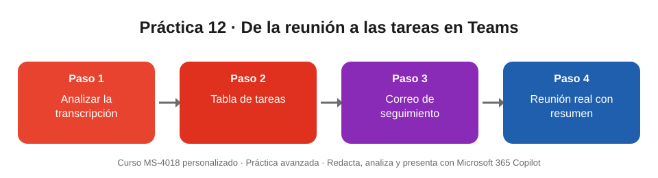

# Práctica 12 (avanzada). De la reunión a las tareas con Copilot en Teams

## Objetivo de la práctica:
Al finalizar la práctica, serás capaz de:
- Extraer decisiones, tareas y desacuerdos de la transcripción de una reunión con Copilot.
- Redactar el correo de seguimiento de una reunión a partir de su contenido.
- Usar Copilot y el resumen inteligente en una reunión real de Teams con transcripción.

## Objetivo Visual


## Duración aproximada:
- 15 minutos.

## Tabla de ayuda:
| Recurso | Valor |
| --- | --- |
| Archivos base | [Transcripcion_Comite_Sucursal_Agil.docx](Transcripcion_Comite_Sucursal_Agil.docx) (comité de seis personas, nueve minutos) · [Guion_Reunion_Prueba_Teams.docx](Guion_Reunion_Prueba_Teams.docx) (texto para leer en una reunión de prueba) |
| Escenario | Banco Meridiano (entidad ficticia): seguimiento del piloto «Sucursal Ágil» |
| Aplicación | Microsoft Teams con Microsoft 365 Copilot |
| Requisitos | Licencia de Microsoft 365 Copilot; transcripción en OneDrive; para la Tarea 3, una reunión de Teams con la transcripción activada |

## Instrucciones
### Tarea 1. Analizar la transcripción del comité.
Paso 1. Descargar la transcripción y subirla a OneDrive.

Paso 2. Abrir **Copilot** en Teams (aplicación Copilot en la barra lateral) y referenciar el archivo con **/** o con el botón **+**.

Paso 3. Escribir:

```
Resume en cinco viñetas la reunión de /Transcripcion_Comite_Sucursal_Agil: qué se decidió y qué quedó pendiente.
```

Paso 4. Escribir:

```
Crea una tabla con todas las tareas acordadas: responsable, tarea y fecha límite.
```

Paso 5. Escribir:

```
¿Qué posición tenían Carlos y Laura sobre los kioscos puente y cómo se resolvió el desacuerdo?
```

### Tarea 2. Redactar el seguimiento.
Paso 1. Escribir:

```
Redacta el correo de seguimiento de Ana para los participantes, con las decisiones, las tareas y la fecha de la próxima reunión. Máximo 150 palabras.
```

Paso 2. Comparar las tareas del correo con la tabla del resultado esperado.

### Tarea 3. Probar con una reunión real (opcional).
Paso 1. En Teams, seleccionar **Calendario > Reunirse ahora** y nombrar la reunión **«Práctica MS4018 · Actualización del piloto»**.

Paso 2. Activar **Grabar y transcribir > Iniciar transcripción** y leer en voz alta el texto de **Guion_Reunion_Prueba_Teams.docx** (unos tres minutos).

Paso 3. Durante la lectura, abrir **Copilot** en los controles de la reunión y preguntar:

```
¿Qué decisiones se han tomado hasta ahora?
```

Paso 4. Terminar la reunión y, cuando aparezca, abrir la pestaña **Resumen** en el chat de la reunión.

Paso 5. Abrir Copilot en la reunión y preguntar:

```
¿Qué riesgos se mencionaron en la reunión y qué pasa si no se resuelven?
```

### Resultado esperado
Tareas que Copilot debe identificar en la transcripción del comité:

| Responsable | Tarea | Fecha |
| --- | --- | --- |
| Jorge Salas | Pedir la cotización formal de 4 kioscos puente y enviarla a Pedro | Antes del 28 oct |
| Pedro Gómez | Presentar la reasignación de USD 60.000 (18.000 alquiler + 42.000 formación y comunicación) | Comité de inversiones, 4 nov |
| Marta Ríos | Plan de comunicación para clientes de 55 años o más; coordinar fechas de Copilot con Daniel | 6 nov |
| Carlos Méndez | Traer el tráfico de clientes de los sábados en la tarde de diciembre del año pasado | Próxima reunión, 4 nov |
| Jorge Salas | Primera versión del tablero de Power BI, con costo por transacción | 15 dic |

Además:
- **Decisión**: alquilar cuatro kioscos puente (dos por sucursal) por USD 18.000 durante tres meses.
- **Desacuerdo resuelto**: Carlos apoyaba el alquiler; Laura prefería arrancar solo con el turno digital. Se resolvió porque la operación de los equipos puente y los definitivos es la misma.
- **Pendiente abierto**: el cierre de los sábados en la tarde en Puerto Azul.
- **Reunión real (Tarea 3)**: riesgo de las dos vacantes de cajero en Puerto Azul; si no se cubren antes del 10 de enero se revisa la fecha de arranque. Próxima reunión el miércoles 4 de noviembre.
